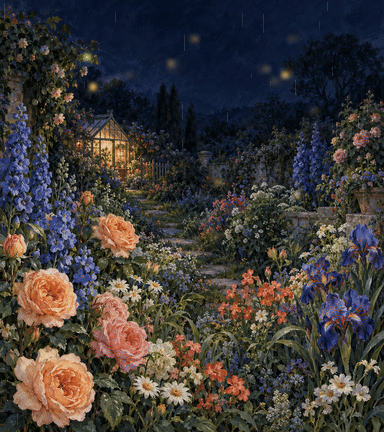

# Painterly Loop GIF

给一幅原创绘景加上轻轻起伏的前景、细雨和萤火光点，导出真正可播放的循环动图。
这是一个 Codex skill：内置图像生成工具负责画背景，FFmpeg 负责位移、粒子和编码。



这段夜雨花园为 **384×432、115 帧、4.79 秒，无限循环**。
[MP4 预览](skills/painterly-loop-gif/assets/examples/night-garden-loop.mp4) ·
[实际解码联系表](skills/painterly-loop-gif/assets/examples/night-garden-decoded-contact.jpg) ·
[手机尺寸预览](skills/painterly-loop-gif/assets/examples/night-garden-mobile.png)

温室和上半部分的几何形状保持原位，下方花床轻微变形，细雨下落，金色光点漂移、闪烁。
底图是一张不透明绘画；前景动作是画面位移，雨和光点是叠加层。它没有模拟独立花茎、
三维景深、真实雨滴撞击或移动镜头。雨与光点仍可能经过保持几何形状的区域。

## 安装到 Codex

把这句话发给 Codex：

> 使用 $skill-installer 安装 https://github.com/LIghtJUNction/painterly-loop-gif/tree/main/skills/painterly-loop-gif

安装后，**下一轮**使用：

> 用 $painterly-loop-gif 做一幅原创月下紫藤庭院的循环动图，油画与水粉质感，固定镜头，建筑放在静止上方区域，前景轻轻起伏，少量细雨和萤火光点，同时输出 MP4。

主题、色彩和构图可以换，前景位移强度、静止区域、粒子数量也可调。
新背景使用内置 `image_gen`，不用另外配置 API key；使用已有背景可以离线渲染。
技能目录内带有脚本、原始示例底图、完整提示词和检查素材，安装器只取得这一目录也能使用。

## 单独运行

需要 Python 3 和系统 FFmpeg/ffprobe，包含 `geq`、`displace`、`scroll`、`blend`、
GIF、FFV1 和 libx264。Python 只用标准库，无需 pip 安装。

```sh
python3 skills/painterly-loop-gif/scripts/render_loop.py \
  --output output/garden.gif \
  --width 384 --fps 24 --duration 4.8 --seed 37 \
  --rain-streaks 62 --fireflies 27 --sway-px 3.2 --protect-top .54
```

不传 `--background` 时使用仓库内的原创花园底图。换成自己的不透明图片：

```sh
python3 skills/painterly-loop-gif/scripts/render_loop.py \
  --background my-scene.png --output output/my-scene.gif \
  --width 384 --rain-streaks 20 --fireflies 12 --sway-px 2 --protect-top .6
```

`--width` 是偶数，输出高度跟随底图比例并取偶数。`--duration` 会对齐到完整帧周期，
GIF 时间按 10 毫秒量化。粒子数量设为 `0` 可关闭那一层；`--protect-top 1` 可让整幅
底图停止几何位移，粒子继续运动。静止区域是按画面高度控制，不能自动识别每栋建筑。
输出名称已存在时需要换名，或明确传入 `--overwrite`。

每个输出名有自己的工作目录与检查文件，多个版本不会共享 `garden-render` 缓存。
渲染逐步通过 FFmpeg 完成，Python 不缓存整段 RGB 帧；运动检查一次只读取一张
64 像素宽的灰度帧，记录帧变化、不同小帧数量和循环边界变化。

## 检查与来源

交付前查看真正导出的 GIF/MP4、解码联系表和手机尺寸预览，检查建筑是否弯曲、粒子
密度与方向、前景是否变形过度，以及循环是否自然。首尾不必是同一张图，循环边界
应继续正常运动。数值变化只能证明画面动了，不能代替视觉检查。

- [底图完整生成提示词](skills/painterly-loop-gif/assets/examples/background-prompt.txt)
- [原始生成底图](skills/painterly-loop-gif/assets/examples/night-garden-background.png)
- [原示例来源、参数与哈希](skills/painterly-loop-gif/assets/examples/manifest.json)
- [绘景选择与实际能力范围](skills/painterly-loop-gif/references/backgrounds.md)

示例背景由内置 `image_gen` 生成，GIF/MP4 由本工作流组装。
视觉灵感来自[这条夜间花园帖子](https://x.com/JenPanepinto/status/2105866106053271986?s=20)。
本仓库不包含下载的参考视频、参考截图或原作者的动画帧，也不宣称知道原帖的制作工程。
示例保留本次原创底图、提示词和实际导出结果，便于检查和复用。

代码使用 [MIT License](LICENSE)。示例为本工作流生成的素材，随仓库提供供演示与复用。
默认动图中不加文字、标识、网址或水印。技能生成素材；对外发布仍需要用户授权。
